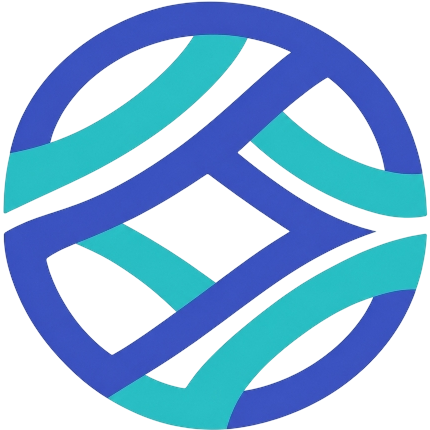

# Клубок

Совместная бесконечная доска для блок-схем со связями, описывающих алгоритмы или процессы. У каждого блока или связи можно оставлять комментарии в режиме чата для обсуждения элемента.

## Особенности

💯 Бесплатный и с открытым исходным кодом.
🎨 Бесконечная доска на основе canvas.
💾 Автосохранение.
📤 Экспорт в PNG, JSON (.klubok).
📥 Импорт из JSON (.klubok).
🖼️ Поддержка изображений.
🌓 Тёмный режим.
🧰 Широкий выбор инструментов: прямоугольник, круг, ромб, стрелка, текст, контейнер.
➡️ Привязка стрелок.
🔍 Поддержка масштабирования и панорамирования.

## Документация

Полная документация: **https://getklubok.github.io/klubok/docs/**

Исходники документации — в каталоге [docs](docs/).

## Лицензия

[GNU AGPL v3](LICENSE).
